# whisli bean

**[Polska wersja](README.pl.md)**

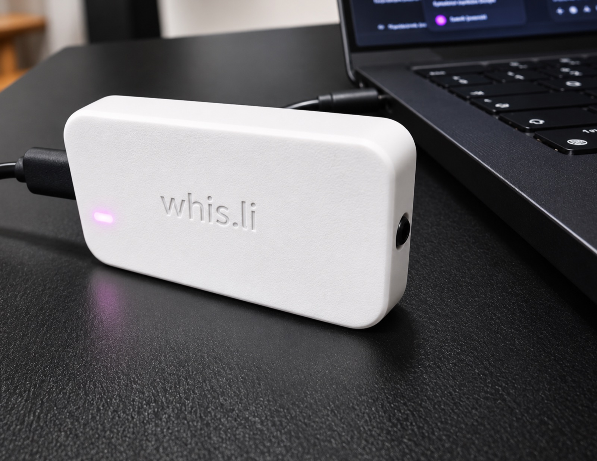

An ESP32-C3 and an IR receiver that let any IR remote control things on your network. The bean learns a remote's buttons, and each button can send MQTT, call a webhook or send Wake-on-LAN.

It runs locally: the web panel is built into the firmware, with no cloud or hub. It's a prototype, so expect rough edges.

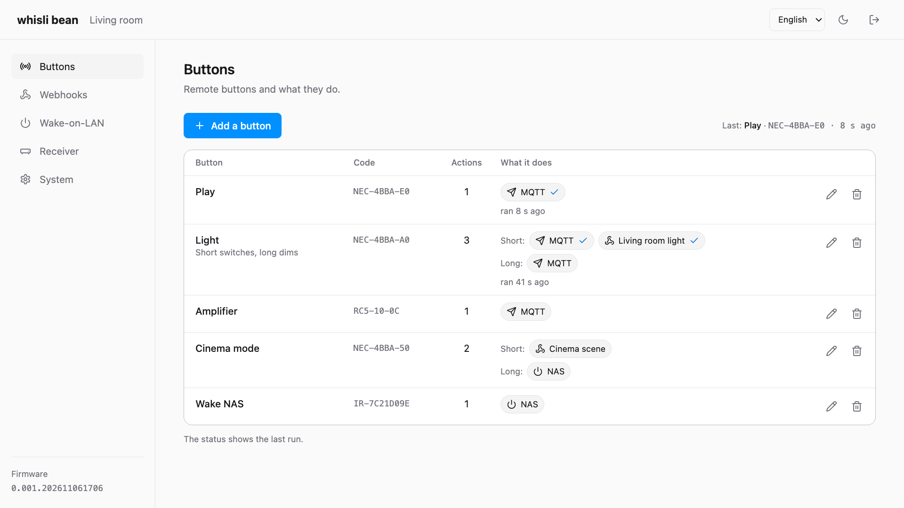

## Features

- **Learning:** NEC, RC5 and RC6 are decoded. Other remotes get a fingerprint based on frame timing.
- **Gestures:** short press and long press (0.8 s). A long press fires once or repeats every 0.3 s while held.
- **Actions per gesture:** MQTT, webhook and Wake-on-LAN, in any combination.
- **Home Assistant:** appears automatically through MQTT Discovery.
- **Receiver view:** live frames with waveform and raw timings.
- **Works without a broker:** webhooks and Wake-on-LAN don't need MQTT.
- **API:** everything in the panel is available over HTTP.
- **OTA updates** over Wi-Fi. The panel is in English and Polish, with light and dark themes.

| | |
|---|---|
| 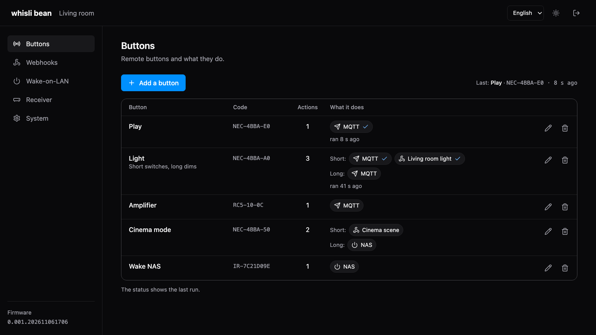 | 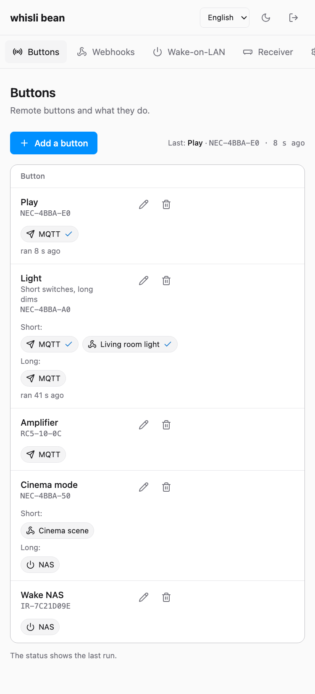 |

The screenshots show the real panel filled with made-up demo data.

## Why a remote?

I have a tablet with Home Assistant in the living room and a phone in my pocket, but the remote is what's within reach. It's faster than the phone: nothing to unlock and no dashboard to find. So I just use it.

This comes from [an older project on my blog (in Polish)](https://smartnie.pl/roznosci/pilot-od-telewizora-jako-centrum-sterowania-domem-w-homeassistant/), where an ESP32 with ESPHome passed remote codes to Home Assistant as events. The bean learns buttons itself, has its own panel and also works without Home Assistant.

### The remote I use: SofaBaton U2

Any IR remote works. I use a **SofaBaton U2** because it gives the most options. With its wheel you can even pick a layout where every button triggers a Home Assistant action.

I recommend keeping what you use most on the main layout. Then, without switching anything, the remote handles the amp, TV, TV tuner, streaming box and Home Assistant straight away. The newer revision has backlit keys and a better wheel.

## Parts

| Part | What it does | Notes |
|---|---|---|
| ESP32-C3 Super Mini | the brains, Wi-Fi, the panel | clones differ in size, so measure yours before printing a case |
| TSOP34438 | IR receiver, 38 kHz | any 38 kHz receiver should do, e.g. a VS1838 |
| 2 magnets, 20 × 10 × 2 mm, with 3M adhesive | stick the case to steel | optional, see [why magnets](#why-magnets) |
| thin silicone wire, about 30 AWG | connects the two | about 55 mm if it goes in the case |
| USB-C cable | power and first flash | |

### Wiring

Three wires, soldered directly to the board.

| TSOP34438 | ESP32-C3 Super Mini |
|---|---|
| 1 OUT | GPIO4 |
| 2 GND | G |
| 3 VS | 3.3 |

Other receivers can have a different pinout, so check the datasheet. The pin is `IR_RECEIVER` in `src/board.h`.

### LEDs

The board has two LEDs and the case has a thin window over each: the power LED (always on while powered) and the IO8 LED on GPIO8, which the firmware controls. Under **System → LED** you choose what IO8 does:

| Mode | What you see |
|---|---|
| Reception | flashes on every frame from a remote; handy for aiming and testing range |
| Sending | flashes when a button really runs its actions |
| Status only | dark while all is well; a flash every 2 s means no Wi-Fi, every 3 s another problem such as MQTT |
| Off | dark, except during a password reset |

Brightness is adjustable, and problems can take priority over the mode.

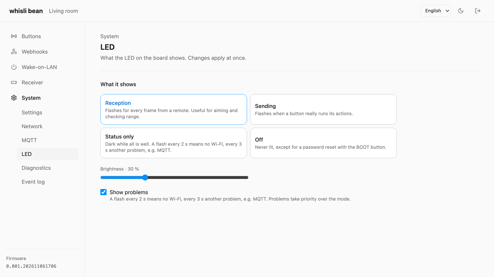

## Install

### Prebuilt firmware

Grab `whisli-bean-full.bin` from the [latest release](https://github.com/tjaworski997/whisli-bean/releases/latest) and flash it at address `0x0`, using either of these:

- **In the browser:** open the [esptool web flasher](https://espressif.github.io/esptool-js/) in Chrome or Edge, click **Connect**, pick the board, set the address to `0x0`, choose the file and click **Program**.
- **From a terminal:**

  ```sh
  pip install esptool
  esptool --chip esp32c3 write-flash 0x0 whisli-bean-full.bin
  ```

Board not showing up? Hold BOOT while you plug it in.

The full image also wipes saved settings and buttons, so use it only for the first install. For updates there's `whisli-bean-update.bin`, see below.

### Build from source

You need [PlatformIO](https://platformio.org/) and Node.js with npm.

```sh
git clone https://github.com/tjaworski997/whisli-bean.git
cd whisli-bean
cd ui && npm ci && cd ..
cp src/local_defaults.example.h src/local_defaults.h   # optional: put your Wi-Fi here
pio run -e whisli-bean -t upload
```

That builds the panel, bakes it into the firmware and flashes it.

### First run

1. **No Wi-Fi in the firmware yet?** That's the case with ready builds. Wait a minute. The bean opens a Wi-Fi network called `Whisli-Bean-XXXX` (password `whisli_gogo`). Join it and go to http://192.168.4.1/.
2. **Sign in** with the password `whisli_gogo`, then change it under **System → Settings**.
3. **Connect to your Wi-Fi** under **System → Network**.
4. **Add a button:** **Buttons → Add a button**, aim the remote, press.

Later versions go over the air: upload `whisli-bean-update.bin` from the [latest release](https://github.com/tjaworski997/whisli-bean/releases/latest), or your own `.pio/build/whisli-bean/firmware.bin`, under **System → Settings → Firmware**. Settings and buttons stay.

Forgot the password? Hold BOOT for 10 s to restore the default.

## Panel

### Buttons

**Add a button** starts learning: press a button on the remote and the code field fills in. Set a name and tick the actions. There's no Save button, changes save automatically.

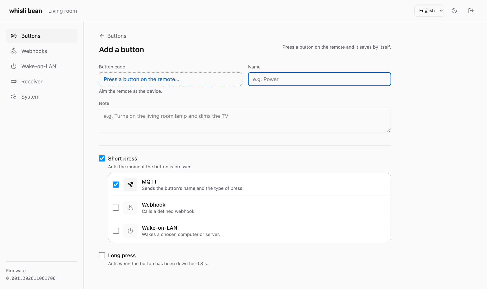

Each gesture has its own actions and a **Test** button. A short press fires immediately, unless long press is also on: then it fires on release, because the bean has to wait to tell them apart.

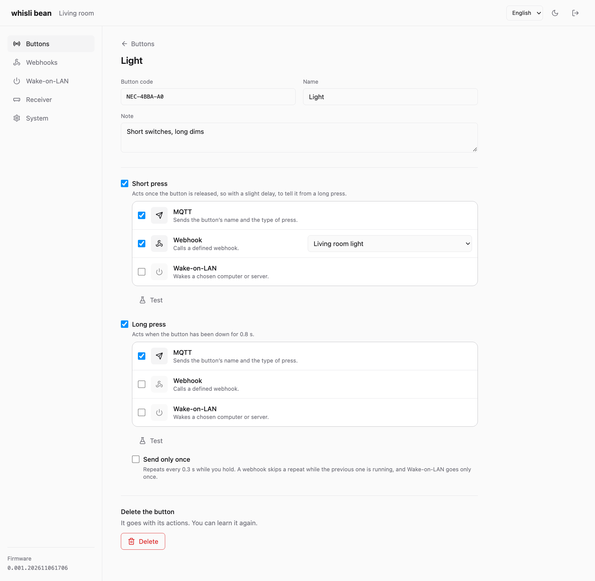

### Webhooks

HTTP or HTTPS requests, defined once and usable from any number of buttons. Each has a method, URL, headers, body and a test button. The URL, headers and body can use these variables:

`{button}` `{code}` `{gesture}` `{controller}` `{ip}` `{time}` `{uptime}`

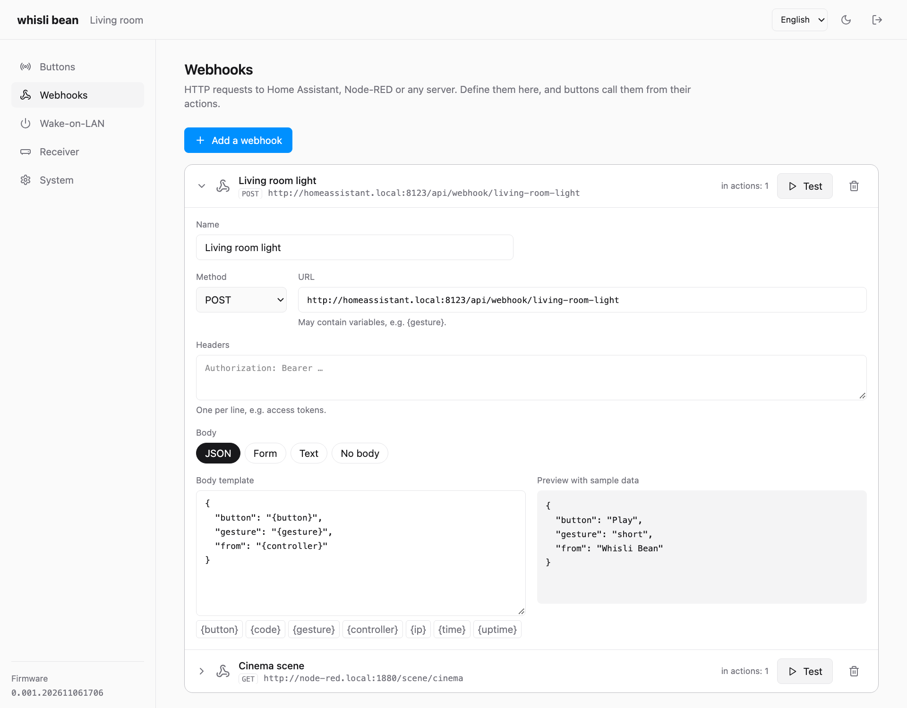

Tokens in headers are stored on the device unencrypted.

### Wake-on-LAN

A list of machines to wake: name, MAC address and an optional broadcast address. Wake-on-LAN has to be enabled in their BIOS and OS.

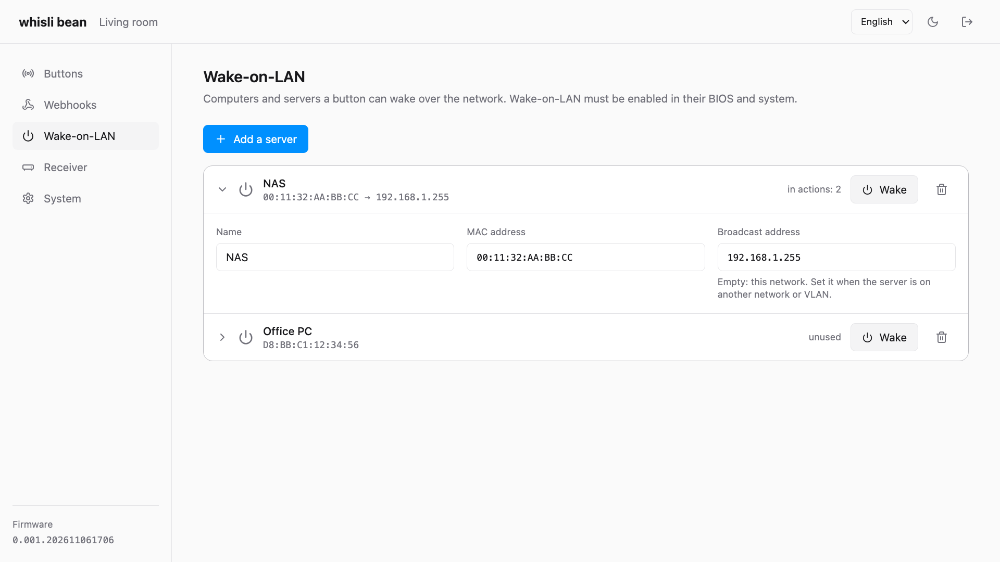

### Receiver

Live list of received frames with protocol, code, waveform and raw timings in microseconds. Use it to check whether the bean sees a remote at all.

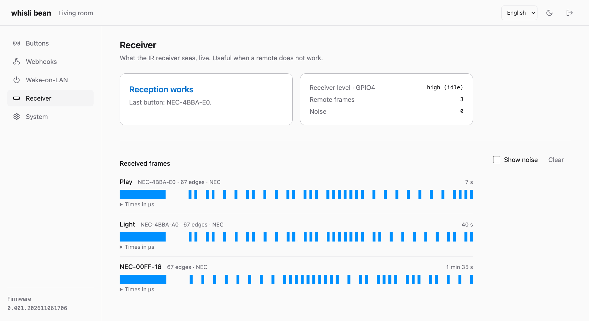

### System

Name, password, firmware, Wi-Fi, MQTT, LED, diagnostics and an event log. Diagnostics shows memory, signal strength and main loop timing, and can download a report.

| | |
|---|---|
| 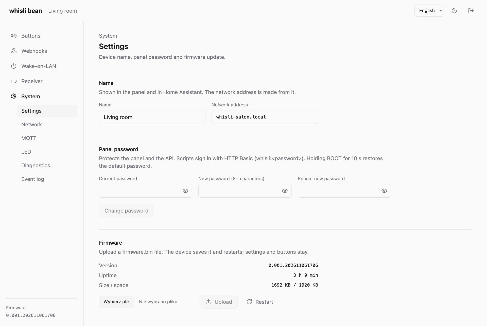 | 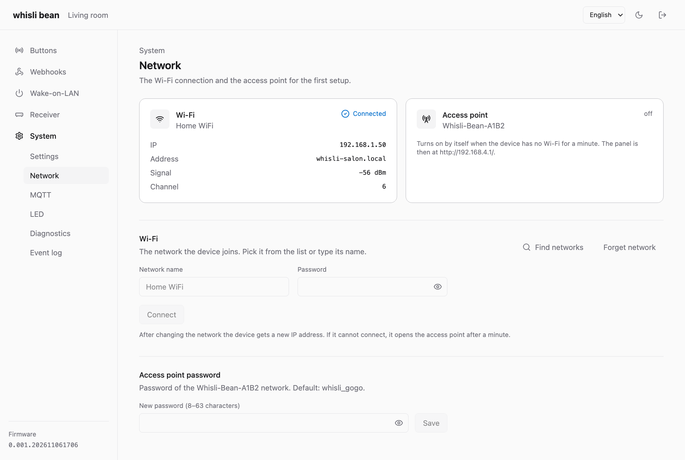 |
| 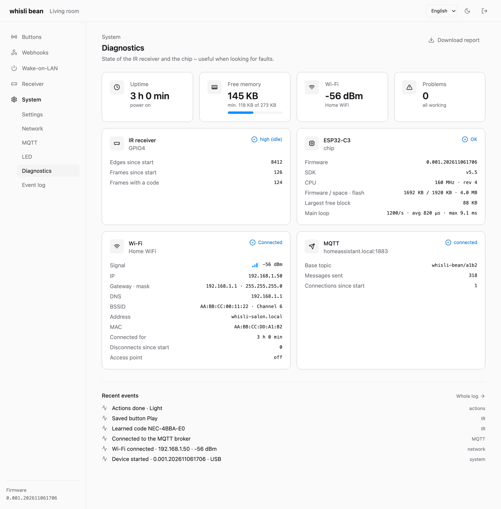 | 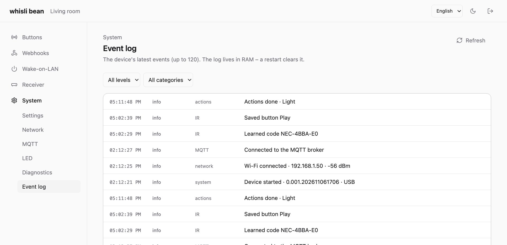 |

## MQTT and Home Assistant

Run a broker (the Mosquitto add-on in Home Assistant is the easy way), make sure the MQTT integration is on, and fill in **System → MQTT**. The bean appears in Home Assistant by itself, with its Wi-Fi signal, an event entity and a trigger for every button that has MQTT ticked.

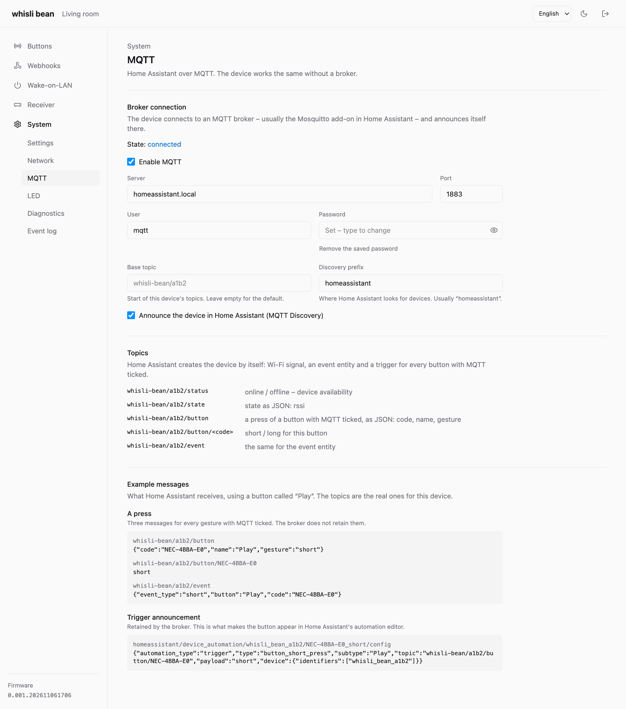

The panel shows these same examples with your device's real topics.

### Messages

The base topic defaults to `whisli-bean/<last 4 of MAC>`. Here's a short press of a button called `Play`, which sends three messages:

```text
whisli-bean/a1b2/button
{"code":"NEC-4BBA-E0","name":"Play","gesture":"short"}

whisli-bean/a1b2/button/NEC-4BBA-E0
short

whisli-bean/a1b2/event
{"event_type":"short","button":"Play","code":"NEC-4BBA-E0"}
```

And this retained message is what makes the button appear in Home Assistant's automation editor:

```text
homeassistant/device_automation/whisli_bean_a1b2/NEC-4BBA-E0_short/config
{"automation_type":"trigger","type":"button_short_press","subtype":"Play","topic":"whisli-bean/a1b2/button/NEC-4BBA-E0","payload":"short","device":{"identifiers":["whisli_bean_a1b2"]}}
```

| Topic | Payload | Retained |
|---|---|---|
| `<base>/status` | `online` / `offline` | yes |
| `<base>/state` | `{"rssi":-56}`, every minute | yes |
| `<base>/button` | JSON: code, name, gesture | no |
| `<base>/button/<code>` | `short` / `long` | no |
| `<base>/event` | JSON for the event entity | no |

To watch them:

```sh
mosquitto_sub -h <broker> -u <user> -P <password> -t 'whisli-bean/#' -v
```

### Example automation

In the automation editor, add a device trigger and pick the button. Or in YAML:

```yaml
triggers:
  - trigger: mqtt
    topic: whisli-bean/a1b2/button/NEC-4BBA-E0
    payload: short
actions:
  - action: light.toggle
    target:
      entity_id: light.living_room
```

## The case

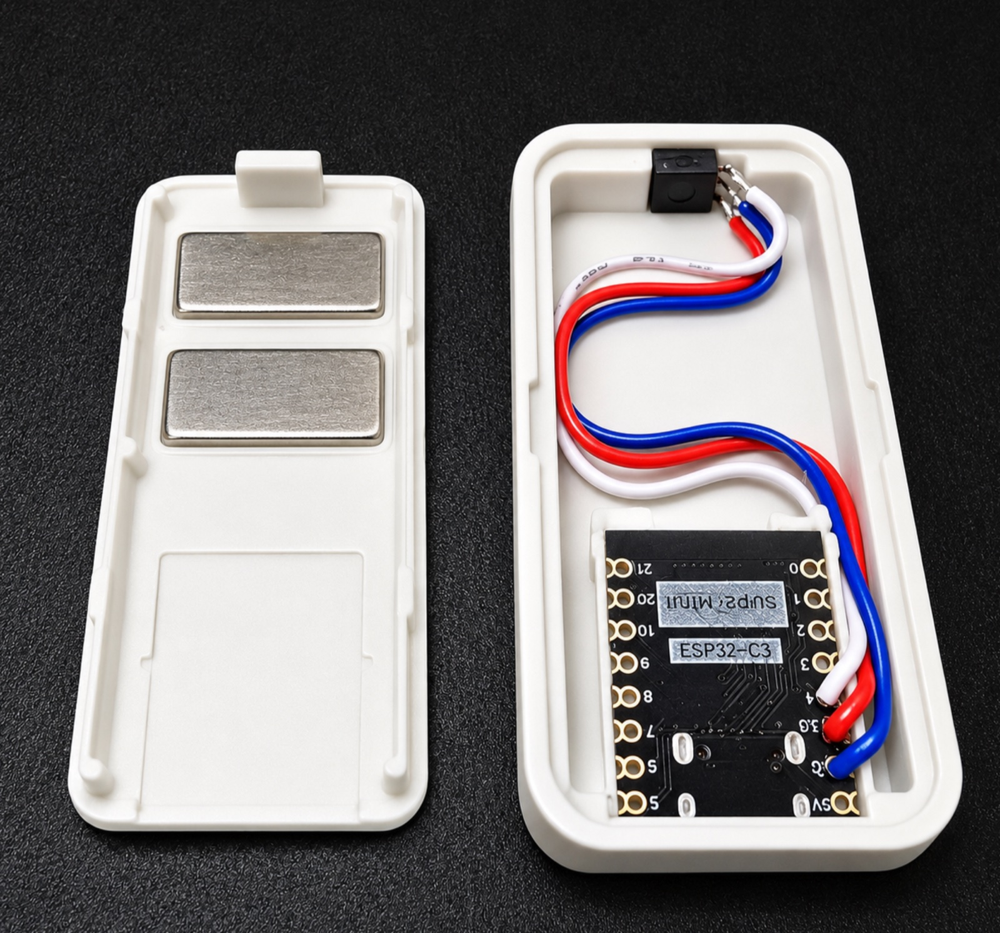

I recommend running the wires from the underside of the board, because then the case closes nicely.

3D-printed, **33 × 66 × 10.4 mm**.

- The receiver's lens pokes out of one end and USB-C sits in the other, both centred on the height.
- The top and sides are one piece, with "whis.li" engraved on top. The outside faces print on the bed, so they come out smooth.
- The LEDs shine through 0.4 mm of plastic, so there are no holes to see. Use a white or light filament.
- The bottom plate clips in and comes off with a fingernail, and the board sits on a light snap.

### Why it's flat

I made the case as flat as I could so it fits under an amplifier, which is where I keep it. It's 10.4 mm tall, so measure the gap under yours first.

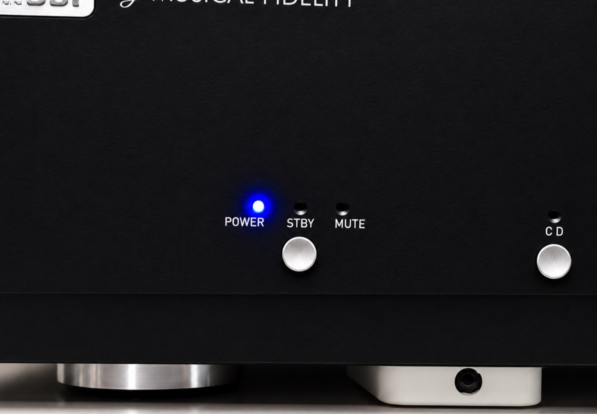

### Why magnets?

Two 20 × 10 × 2 mm magnets inside the plate let you stick the bean to the side of a device, or to anything else made of steel, with no screws. I still prefer it under the amp. There's 0.6 mm of plastic between the magnets and the steel.

You can get these magnets on Amazon and similar sites. Buy the version with 3M adhesive, so you can just stick them into the seats.

I was worried the magnets would hurt the Wi-Fi range, with a lump of metal that close to the antenna and a big steel box right next to it. It works fine in my setup. The antenna is about 10 mm from the nearest magnet. On other metal surfaces, check the signal in **Diagnostics**.

Two things to watch out for:

- **Slide it off, don't pull it away.** The magnets can hold harder than the clips, so a straight pull may leave the plate stuck to the device.
- **PLA softens at around 55–60 °C,** so near a warm amp print it in ASA or PETG.

Everything else, including STL files, assembly steps, print settings and the dimensions to measure first, is in [`hardware/enclosure/README.md`](hardware/enclosure/README.md).

## Ideas

- Hold a button to dim a light: a long press with **Send only once** unticked repeats every 0.3 s.
- Use a remote from a device you no longer have.
- Wake your PC with a long press, and turn on the amp with a short one.
- Point a webhook at Node-RED, n8n or your own script.
- Try every remote in the house on the **Receiver** page and compare the waveforms.
- Add IR sending: `GET /api/v1/ir` already returns raw timings, but sending isn't implemented and needs an IR LED.
- Remix the case: `hardware/enclosure/print/whisli-bean-obudowa.step` opens in any CAD program.
- Add a protocol to `src/ir_decode.cpp`. It has no Arduino dependencies, so you can test it on your computer.

## Development

| What | How |
|---|---|
| Build the panel and firmware | `pio run -e whisli-bean` |
| Firmware only | `WHISLI_BEAN_SKIP_UI=1 pio run -e whisli-bean` |
| Flash over Wi-Fi | `WHISLI_BEAN_PASSWORD=<password> pio run -e ota -t upload --upload-port <ip>` |
| Panel dev server against a live board | `cd ui && BEAN_DEVICE_URL=http://<ip> npm run dev` |
| Tests without a board | `scripts/test.sh` |
| Test a live board (adds and removes data) | `WHISLI_BEAN_PASSWORD=<password> scripts/smoke.py <ip>` |
| Rebuild these screenshots (no board needed) | `scripts/screens.sh` |

The panel is React with TypeScript, and the firmware is Arduino on PlatformIO.

**Known quirk:** transmit power is capped at 8.5 dBm in `src/net.cpp`, because at full power this Super Mini wouldn't finish the Wi-Fi handshake. Yours may be fine at higher power.

**Limits:** 64 buttons, 20 webhooks, 16 Wake-on-LAN servers, 120 log entries (in RAM).

## What won't work

Radio and Bluetooth remotes, remotes on another carrier such as 56 kHz, and air conditioners, whose frames carry the unit's whole state, so one button doesn't have one code. Fingerprinted remotes have no checksum, so learning them needs the same frame twice.

## API

Answers are JSON and errors look like `{"error":"<code>"}`. POST takes form fields. Everything except `auth` needs a panel session or HTTP Basic:

```sh
curl -u whisli:<password> http://<ip>/api/v1/state
```

| Route | What it does |
|---|---|
| `GET /api/v1/auth` · `POST …/login` · `…/logout` · `…/password` | sign-in and password |
| `GET /api/v1/state` · WebSocket `/api/v1/ws` | live state |
| `GET /api/v1/ir?since=<id>` | latest frames with timings and codes |
| `GET`/`POST /api/v1/ir/learn` · `POST …/cancel` | learning: state, start, cancel |
| `GET`/`POST /api/v1/buttons` · `POST …/delete` · `…/test` | list, save (`code`, `name`, optional `note`, `gestures`, `actions` as JSON), delete (`code`), test (`code`, `gesture`) |
| `GET`/`POST /api/v1/hooks` · `GET …/detail?id=` · `POST …/update` · `…/remove` · `POST`/`GET …/test` | webhooks: list, add (`name`), details, save, remove, test and its result |
| `GET`/`POST /api/v1/servers` · `POST …/update` · `…/remove` · `…/wake` | Wake-on-LAN: list, add (`name`), save (`id`, `name`, `mac`, `broadcast`), remove, wake |
| `GET`/`POST /api/v1/wifi` · `POST …/forget` · `…/ap` · `GET`/`POST …/scan` | network |
| `GET`/`POST /api/v1/mqtt` | MQTT settings |
| `POST /api/v1/device` | device name |
| `GET`/`POST /api/v1/led` | LED: `mode` (`off`, `status`, `received`, `sent`), `brightness` (1–100), `alerts` |
| `GET /api/v1/system` · `POST …/restart` · `GET /api/v1/diagnostics` · `GET /api/v1/logs` | system |
| `POST /api/v1/firmware` | new firmware as a raw body (`application/octet-stream`) |

A button's `actions` looks like this, and `gestures` is `1` when the long press is on:

```json
{"short":{"enabled":true,"mqtt":true,"webhook":3,"wol":1},"long":{"enabled":false}}
```

Each action reports its last run as `pending`, `running`, `ok` or `failed`, in `runs` from `GET /api/v1/buttons` and live in `actions.run`.
