# whisli bean

**[English version](README.md)**

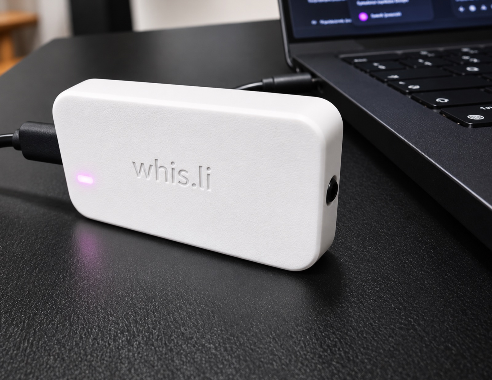

ESP32-C3 i odbiornik IR, dzięki którym dowolny pilot IR steruje rzeczami w sieci. Bean uczy się przycisków pilota, a każdy przycisk może wysłać MQTT, wywołać webhook albo Wake-on-LAN.

Działa lokalnie: panel WWW jest wbudowany w firmware, bez chmury i huba. To prototyp, więc miejscami może być szorstko.

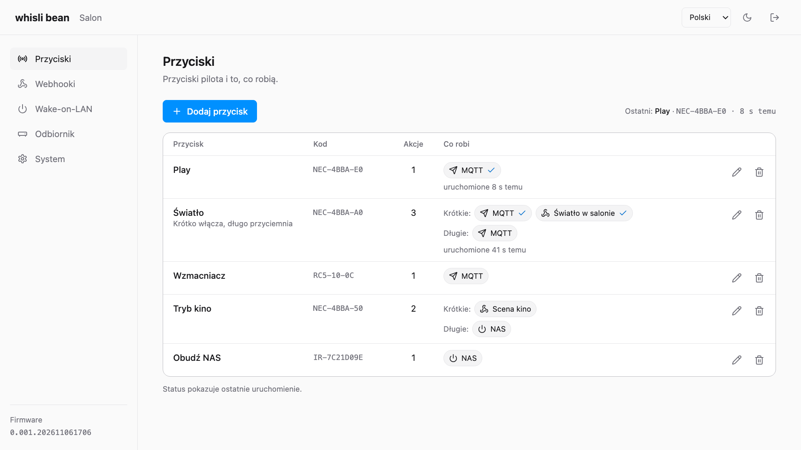

## Funkcje

- **Uczenie:** NEC, RC5 i RC6 są dekodowane. Inne piloty dostają odcisk z rytmu ramki.
- **Gesty:** krótkie i długie naciśnięcie (0,8 s). Długie działa raz albo powtarza się co 0,3 s, dopóki trzymasz.
- **Akcje dla gestu:** MQTT, webhook i Wake-on-LAN, w dowolnej kombinacji.
- **Home Assistant:** urządzenie pojawia się samo przez MQTT Discovery.
- **Podgląd odbiornika:** ramki na żywo z przebiegiem i surowymi czasami.
- **Działa bez brokera:** webhooki i Wake-on-LAN nie potrzebują MQTT.
- **API:** wszystko z panelu jest dostępne przez HTTP.
- **Aktualizacje OTA** przez Wi-Fi. Panel jest po polsku i angielsku, w jasnym i ciemnym motywie.

| | |
|---|---|
| 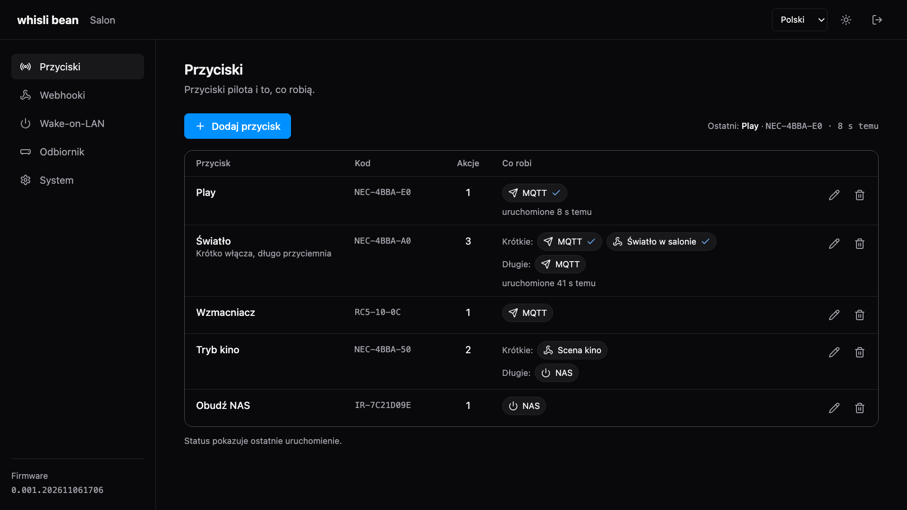 | 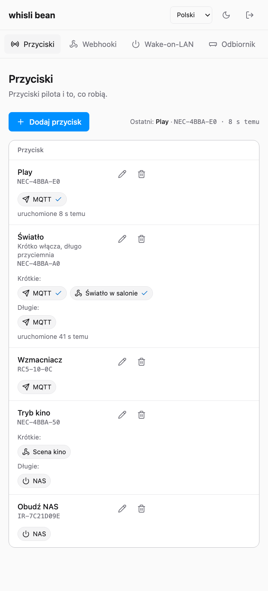 |

Na zrzutach jest prawdziwy panel z wymyślonymi danymi demo.

## Dlaczego pilot?

W salonie mam tablet z Home Assistantem, w kieszeni telefon, ale pod ręką jest pilot. Mam do niego szybszy dostęp niż do telefonu: nic nie odblokowuję i nie szukam dashboardu. Po prostu z niego korzystam.

Pomysł pochodzi z [mojego starszego projektu na blogu](https://smartnie.pl/roznosci/pilot-od-telewizora-jako-centrum-sterowania-domem-w-homeassistant/), w którym ESP32 z ESPHome przekazywał kody z pilota do Home Assistanta jako zdarzenia. Bean sam uczy się przycisków, ma własny panel i działa też bez Home Assistanta.

### Mój pilot: SofaBaton U2

Zadziała każdy pilot IR. Ja używam **SofaBatona U2**, bo daje największe możliwości. Kółkiem można nawet wybrać układ, w którym każdy przycisk odpowiada za akcję w Home Assistancie.

Rekomenduję trzymać to, z czego korzystasz najczęściej, na głównych ustawieniach. Wtedy bez przełączania masz w pilocie obsługę wzmacniacza, telewizora, tunera telewizji, urządzenia streamingowego i Home Assistanta. Nowsza rewizja ma podświetlane klawisze i poprawione kółko.

## Części

| Część | Do czego | Uwagi |
|---|---|---|
| ESP32-C3 Super Mini | mózg, Wi-Fi, panel | klony różnią się wymiarami, więc zmierz swój przed drukiem obudowy |
| TSOP34438 | odbiornik IR, 38 kHz | powinien pasować każdy na 38 kHz, np. VS1838 |
| 2 magnesy 20 × 10 × 2 mm z taśmą 3M | trzymają obudowę na stali | opcjonalne, patrz [po co magnesy](#po-co-magnesy) |
| cienki przewód silikonowy, ok. 30 AWG | łączy jedno z drugim | ok. 55 mm, jeśli ma wejść do obudowy |
| kabel USB-C | zasilanie i pierwsze wgranie | |

### Połączenia

Trzy przewody, lutowane wprost do płytki.

| TSOP34438 | ESP32-C3 Super Mini |
|---|---|
| 1 OUT | GPIO4 |
| 2 GND | G |
| 3 VS | 3.3 |

Inne odbiorniki mogą mieć inny układ pinów, więc sprawdź kartę katalogową. Pin ustawia `IR_RECEIVER` w `src/board.h`.

### Diody

Na płytce są dwie diody, a w obudowie nad każdą jest cienkie okienko: dioda zasilania (świeci, gdy jest prąd) i IO8 na GPIO8, którą steruje firmware. W **System → LED** wybierasz, co ma pokazywać IO8:

| Tryb | Co widać |
|---|---|
| Odbiór | miga przy każdej ramce z pilota; przydaje się do celowania i sprawdzania zasięgu |
| Wysłanie | miga, gdy przycisk naprawdę wykonuje akcje |
| Tylko stan | ciemna, gdy wszystko gra; błysk co 2 s to brak Wi-Fi, co 3 s inny problem, np. MQTT |
| Wyłączona | ciemna, poza resetem hasła |

Jasność da się regulować, a problemy mogą mieć pierwszeństwo przed trybem.

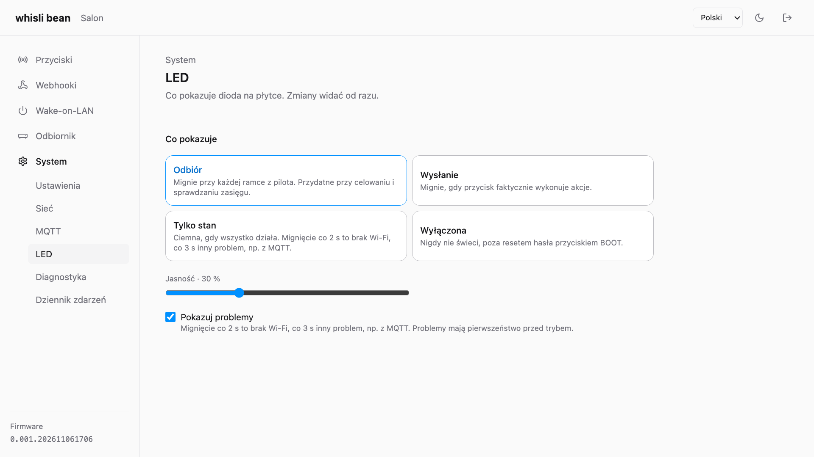

## Instalacja

### Gotowy firmware

Pobierz `whisli-bean-full.bin` z [najnowszego wydania](https://github.com/tjaworski997/whisli-bean/releases/latest) i wgraj go pod adres `0x0`, na jeden z dwóch sposobów:

- **W przeglądarce:** otwórz [wgrywarkę esptool](https://espressif.github.io/esptool-js/) w Chrome lub Edge, kliknij **Connect**, wybierz płytkę, ustaw adres `0x0`, wskaż plik i kliknij **Program**.
- **W terminalu:**

  ```sh
  pip install esptool
  esptool --chip esp32c3 write-flash 0x0 whisli-bean-full.bin
  ```

Płytka się nie pokazuje? Przytrzymaj BOOT przy podłączaniu.

Pełny obraz kasuje też zapisane ustawienia i przyciski, więc jest tylko do pierwszej instalacji. Do aktualizacji służy `whisli-bean-update.bin`, opis niżej.

### Budowanie ze źródeł

Potrzebujesz [PlatformIO](https://platformio.org/) i Node.js z npm.

```sh
git clone https://github.com/tjaworski997/whisli-bean.git
cd whisli-bean
cd ui && npm ci && cd ..
cp src/local_defaults.example.h src/local_defaults.h   # opcjonalnie: wpisz tu swoje Wi-Fi
pio run -e whisli-bean -t upload
```

To zbuduje panel, wtopi go w firmware i wgra na płytkę.

### Pierwsze uruchomienie

1. **W firmware nie ma jeszcze Wi-Fi?** Tak jest w gotowych buildach. Poczekaj minutę. Bean otworzy sieć Wi-Fi `Whisli-Bean-XXXX` (hasło `whisli_gogo`). Połącz się z nią i wejdź na http://192.168.4.1/.
2. **Zaloguj się** hasłem `whisli_gogo`, a potem zmień je w **System → Ustawienia**.
3. **Podłącz swoje Wi-Fi** w **System → Sieć**.
4. **Dodaj przycisk:** **Przyciski → Dodaj przycisk**, wyceluj pilotem, naciśnij.

Kolejne wersje lecą przez Wi-Fi: wgraj `whisli-bean-update.bin` z [najnowszego wydania](https://github.com/tjaworski997/whisli-bean/releases/latest) albo własny `.pio/build/whisli-bean/firmware.bin` w **System → Ustawienia → Firmware**. Ustawienia i przyciski zostają.

Zapomniane hasło? Przytrzymaj BOOT przez 10 s, a wróci domyślne.

## Panel

### Przyciski

**Dodaj przycisk** uruchamia uczenie: naciskasz przycisk na pilocie i pole kodu się wypełnia. Ustawiasz nazwę i zaznaczasz akcje. Nie ma przycisku Zapisz, zmiany zapisują się same.

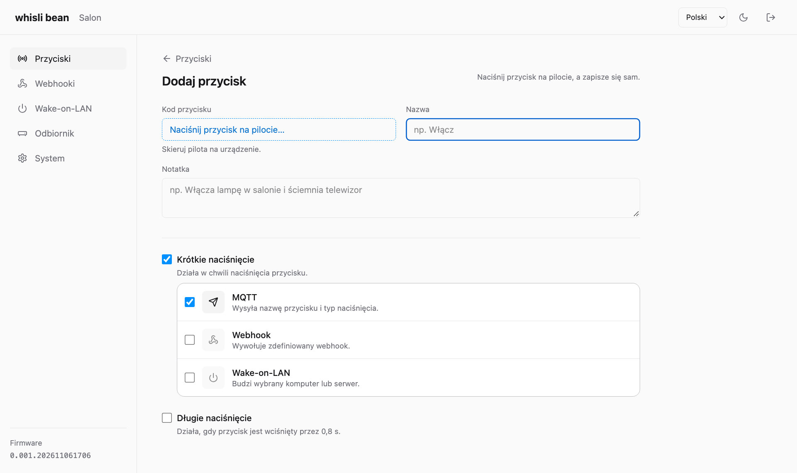

Każdy gest ma własne akcje i przycisk **Test**. Krótkie naciśnięcie działa od razu, chyba że włączone jest też długie: wtedy dopiero po puszczeniu, bo bean musi je odróżnić.

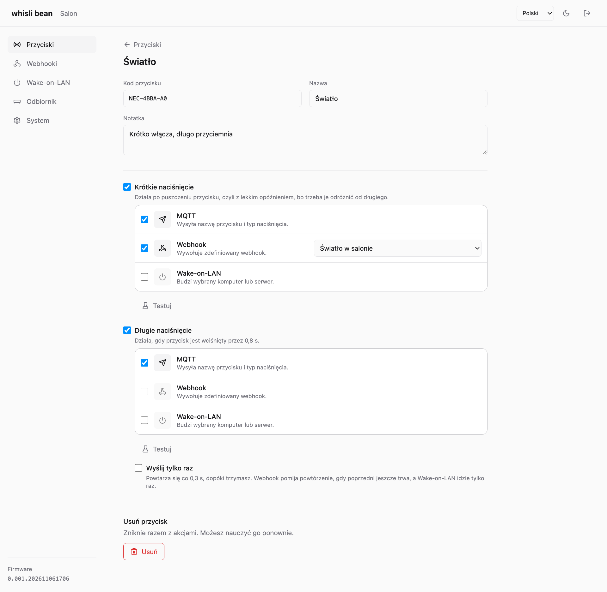

### Webhooki

Zapytania HTTP lub HTTPS, definiowane raz i dostępne dla dowolnej liczby przycisków. Każde ma metodę, adres, nagłówki, treść i przycisk testu. W adresie, nagłówkach i treści można użyć zmiennych:

`{button}` `{code}` `{gesture}` `{controller}` `{ip}` `{time}` `{uptime}`

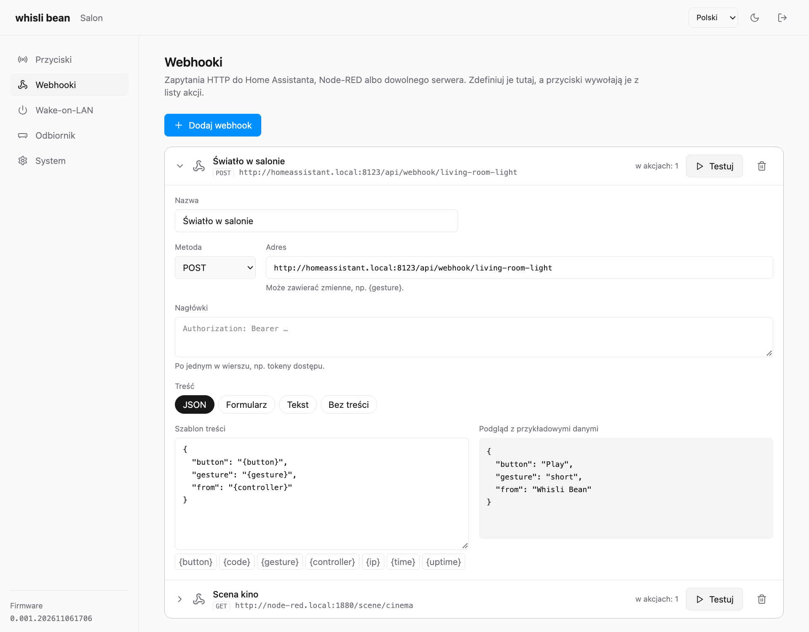

Tokeny z nagłówków są na urządzeniu bez szyfrowania.

### Wake-on-LAN

Lista maszyn do budzenia: nazwa, adres MAC i opcjonalny adres rozgłoszeniowy. Wake-on-LAN musi być włączony w ich BIOS-ie i systemie.

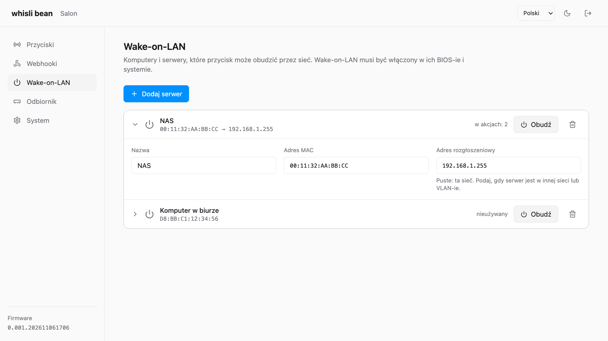

### Odbiornik

Lista odbieranych ramek na żywo: protokół, kod, przebieg i surowe czasy w mikrosekundach. Przydaje się, gdy trzeba sprawdzić, czy bean w ogóle widzi pilota.

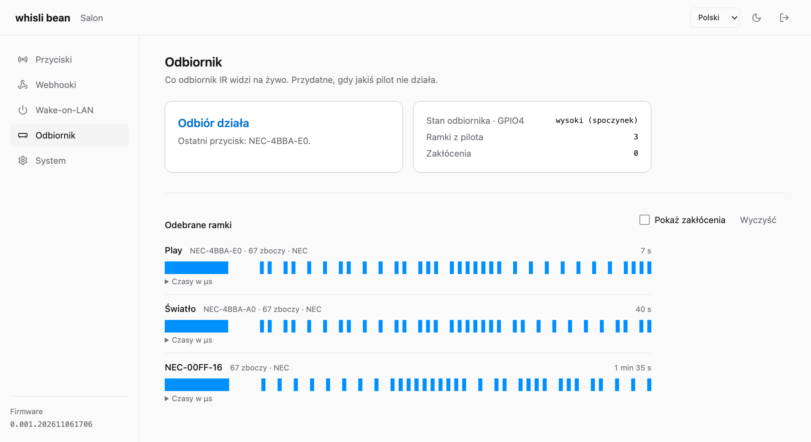

### System

Nazwa, hasło, firmware, Wi-Fi, MQTT, dioda, diagnostyka i dziennik zdarzeń. Diagnostyka pokazuje pamięć, siłę sygnału i czasy głównej pętli, a raport można pobrać.

| | |
|---|---|
| 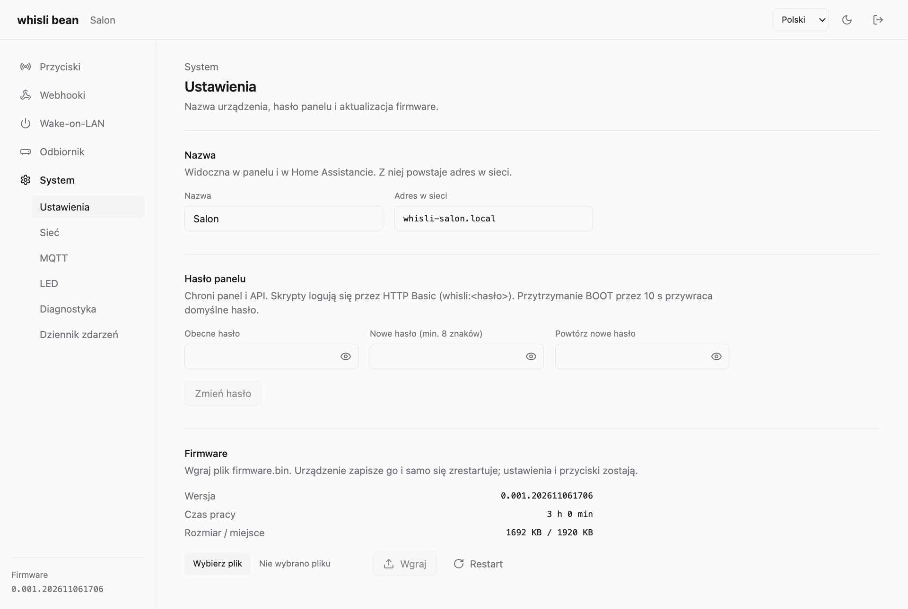 | 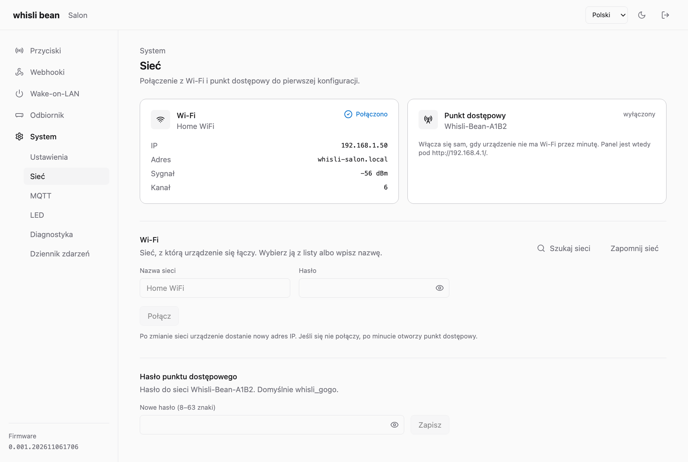 |
| 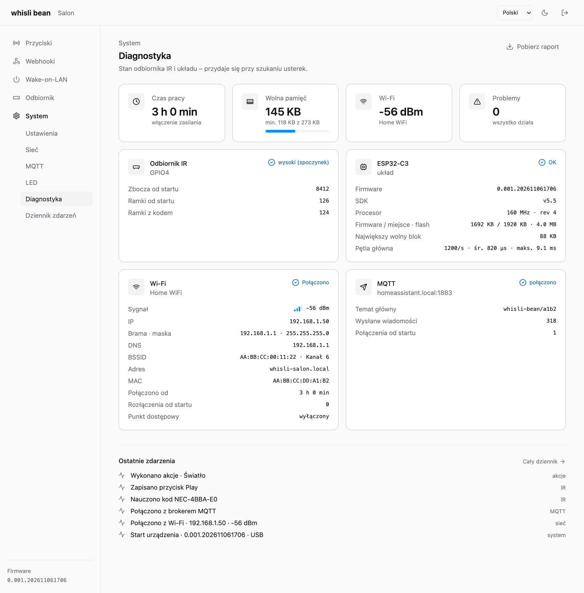 | 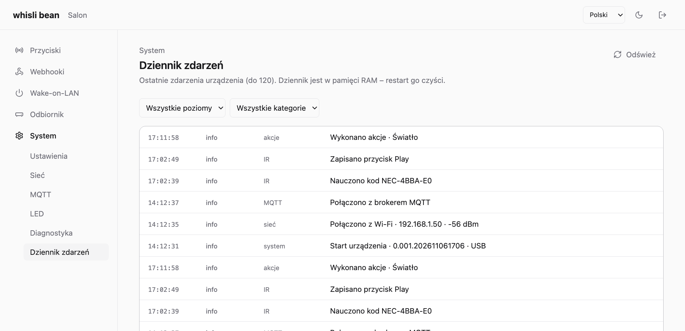 |

## MQTT i Home Assistant

Uruchom brokera (najprościej dodatek Mosquitto w Home Assistancie), sprawdź, czy integracja MQTT jest włączona, i wypełnij **System → MQTT**. Bean sam pojawi się w Home Assistancie: z sygnałem Wi-Fi, encją zdarzeń i wyzwalaczem dla każdego przycisku z zaznaczonym MQTT.

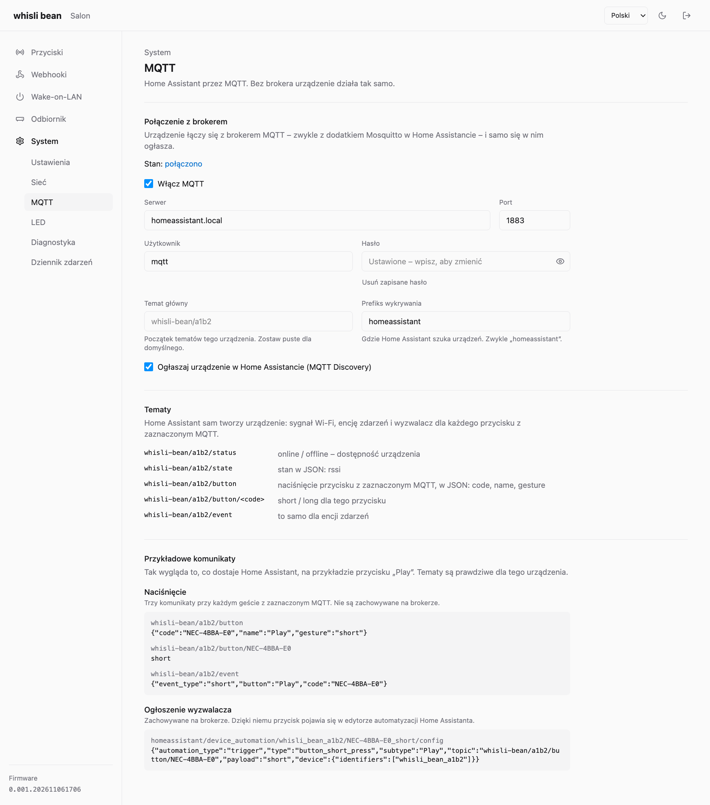

Panel pokazuje te same przykłady z prawdziwymi tematami twojego urządzenia.

### Komunikaty

Temat główny to domyślnie `whisli-bean/<4 ostatnie znaki MAC>`. Tak wygląda krótkie naciśnięcie przycisku `Play`, czyli trzy komunikaty:

```text
whisli-bean/a1b2/button
{"code":"NEC-4BBA-E0","name":"Play","gesture":"short"}

whisli-bean/a1b2/button/NEC-4BBA-E0
short

whisli-bean/a1b2/event
{"event_type":"short","button":"Play","code":"NEC-4BBA-E0"}
```

A ten komunikat, zachowywany na brokerze, sprawia, że przycisk pojawia się w edytorze automatyzacji Home Assistanta:

```text
homeassistant/device_automation/whisli_bean_a1b2/NEC-4BBA-E0_short/config
{"automation_type":"trigger","type":"button_short_press","subtype":"Play","topic":"whisli-bean/a1b2/button/NEC-4BBA-E0","payload":"short","device":{"identifiers":["whisli_bean_a1b2"]}}
```

| Temat | Treść | Zachowywany |
|---|---|---|
| `<base>/status` | `online` / `offline` | tak |
| `<base>/state` | `{"rssi":-56}`, co minutę | tak |
| `<base>/button` | JSON: code, name, gesture | nie |
| `<base>/button/<code>` | `short` / `long` | nie |
| `<base>/event` | JSON dla encji zdarzeń | nie |

Podgląd:

```sh
mosquitto_sub -h <broker> -u <użytkownik> -P <hasło> -t 'whisli-bean/#' -v
```

### Przykładowa automatyzacja

W edytorze automatyzacji dodaj wyzwalacz urządzenia i wybierz przycisk. Albo w YAML:

```yaml
triggers:
  - trigger: mqtt
    topic: whisli-bean/a1b2/button/NEC-4BBA-E0
    payload: short
actions:
  - action: light.toggle
    target:
      entity_id: light.salon
```

## Obudowa

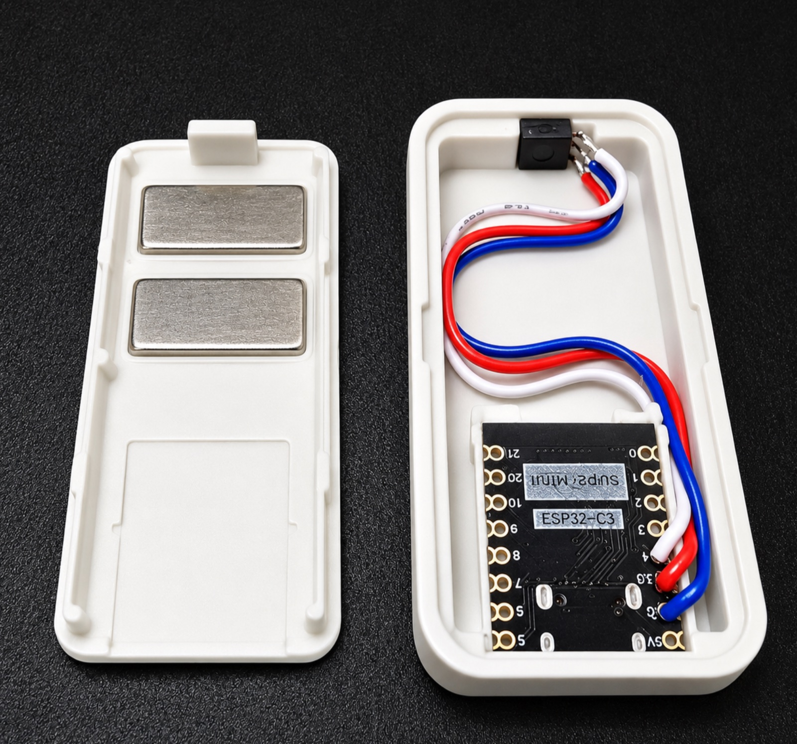

Rekomenduję kabelki od spodu płytki, bo wtedy obudowa ładnie się zamyka.

Drukowana w 3D, **33 × 66 × 10,4 mm**.

- Soczewka odbiornika wystaje z jednego końca, a USB-C jest w drugim, oba w połowie wysokości.
- Góra i boki to jedna bryła z wygrawerowanym napisem „whis.li”. Zewnętrzne ściany drukują się na stole, więc wychodzą gładkie.
- Diody świecą przez 0,4 mm plastiku, więc nie widać żadnych dziur. Użyj białego albo jasnego filamentu.
- Dno wchodzi na zaczepy i schodzi paznokciem, a płytka trzyma się na lekkim zatrzasku.

### Dlaczego płaska

Starałem się zrobić obudowę jak najbardziej płaską, żeby wchodziła pod wzmacniacz, i tam ją trzymam. Ma 10,4 mm wysokości, więc najpierw zmierz prześwit pod swoim.

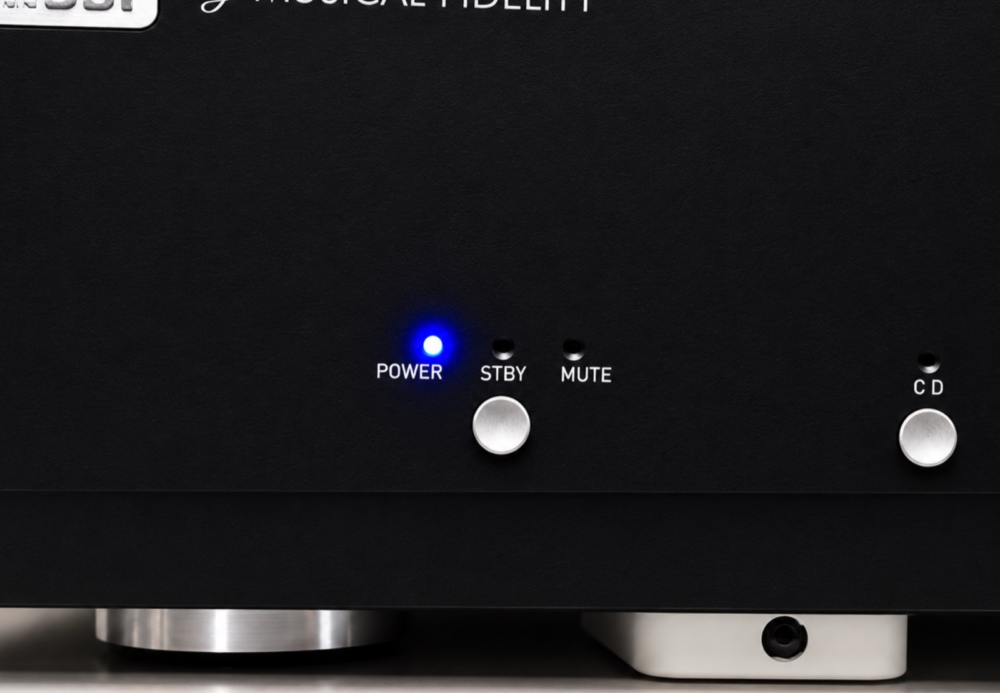

### Po co magnesy?

Dwa magnesy 20 × 10 × 2 mm w środku, na dnie, pozwalają przyczepić beana do boku jakiegoś urządzenia albo do czegokolwiek ze stali, bez śrub. Ja jednak wolę wersję pod spodem. Od stali dzieli je 0,6 mm plastiku.

Takie magnesy są na Amazonie i innych portalach. Kupuj wersję z taśmą 3M, wtedy wystarczy wkleić je w gniazda.

Obawiałem się, że magnesy osłabią zasięg Wi-Fi: kawał metalu tak blisko anteny, a do tego duża stalowa skrzynka tuż obok. U mnie działa. Antena jest ok. 10 mm od najbliższego magnesu. Na innych metalowych powierzchniach sprawdź sygnał w **Diagnostyce**.

Dwie rzeczy, na które trzeba uważać:

- **Zsuwaj, nie odrywaj.** Magnesy mogą trzymać mocniej niż zaczepy, więc po ciągnięciu na wprost dno może zostać na urządzeniu.
- **PLA mięknie przy ok. 55–60°C,** więc przy ciepłym wzmacniaczu drukuj z ASA albo PETG.

Cała reszta, czyli pliki STL, montaż, ustawienia druku i wymiary do zmierzenia, jest w [`hardware/enclosure/README.pl.md`](hardware/enclosure/README.pl.md).

## Pomysły

- Ściemnianie światła przytrzymaniem: długie naciśnięcie z odznaczonym **Wyślij tylko raz** powtarza się co 0,3 s.
- Użyj pilota od urządzenia, którego już nie masz.
- Długim naciśnięciem budź komputer, a krótkim włączaj wzmacniacz.
- Skieruj webhook na Node-RED, n8n albo własny skrypt.
- Przetestuj wszystkie piloty w domu na stronie **Odbiornik** i porównaj przebiegi.
- Dorób wysyłanie IR: `GET /api/v1/ir` zwraca już surowe czasy, ale wysyłania nie ma i potrzebna jest dioda IR.
- Przerób obudowę: `hardware/enclosure/print/whisli-bean-obudowa.step` otworzysz w każdym programie CAD.
- Dodaj protokół w `src/ir_decode.cpp`. Nie zależy od Arduino, więc przetestujesz go na komputerze.

## Rozwój

| Co | Jak |
|---|---|
| Build panelu i firmware | `pio run -e whisli-bean` |
| Tylko firmware | `WHISLI_BEAN_SKIP_UI=1 pio run -e whisli-bean` |
| Wgranie przez Wi-Fi | `WHISLI_BEAN_PASSWORD=<hasło> pio run -e ota -t upload --upload-port <ip>` |
| Panel dev na żywej płytce | `cd ui && BEAN_DEVICE_URL=http://<ip> npm run dev` |
| Testy bez płytki | `scripts/test.sh` |
| Test żywej płytki (dodaje i usuwa dane) | `WHISLI_BEAN_PASSWORD=<hasło> scripts/smoke.py <ip>` |
| Odtworzenie tych zrzutów (bez płytki) | `scripts/screens.sh` |

Panel to React z TypeScriptem, a firmware to Arduino na PlatformIO.

**Znany problem:** moc nadawania jest ograniczona do 8,5 dBm w `src/net.cpp`, bo przy pełnej ta Super Mini nie kończyła handshake'u Wi-Fi. Twoja może działać na wyższej mocy.

**Limity:** 64 przyciski, 20 webhooków, 16 serwerów Wake-on-LAN, 120 wpisów dziennika (w RAM).

## Co nie zadziała

Piloty radiowe i Bluetooth, piloty z inną nośną, np. 56 kHz, oraz klimatyzacje, których ramka niesie cały stan urządzenia, więc jeden przycisk nie ma jednego kodu. Piloty rozpoznawane po odcisku nie mają sumy kontrolnej, więc przy uczeniu ta sama ramka musi pojawić się dwa razy.

## API

Odpowiedzi to JSON, a błędy wyglądają tak: `{"error":"<kod>"}`. POST przyjmuje pola formularza. Wszystko poza `auth` wymaga sesji z panelu albo HTTP Basic:

```sh
curl -u whisli:<hasło> http://<ip>/api/v1/state
```

| Trasa | Działanie |
|---|---|
| `GET /api/v1/auth` · `POST …/login` · `…/logout` · `…/password` | logowanie i hasło |
| `GET /api/v1/state` · WebSocket `/api/v1/ws` | stan na żywo |
| `GET /api/v1/ir?since=<id>` | ostatnie ramki z czasami i kodami |
| `GET`/`POST /api/v1/ir/learn` · `POST …/cancel` | uczenie: stan, start, anulowanie |
| `GET`/`POST /api/v1/buttons` · `POST …/delete` · `…/test` | lista, zapis (`code`, `name`, opcjonalnie `note`, `gestures`, `actions` jako JSON), usunięcie (`code`), test (`code`, `gesture`) |
| `GET`/`POST /api/v1/hooks` · `GET …/detail?id=` · `POST …/update` · `…/remove` · `POST`/`GET …/test` | webhooki: lista, dodanie (`name`), szczegóły, zapis, usunięcie, test i jego wynik |
| `GET`/`POST /api/v1/servers` · `POST …/update` · `…/remove` · `…/wake` | Wake-on-LAN: lista, dodanie (`name`), zapis (`id`, `name`, `mac`, `broadcast`), usunięcie, obudzenie |
| `GET`/`POST /api/v1/wifi` · `POST …/forget` · `…/ap` · `GET`/`POST …/scan` | sieć |
| `GET`/`POST /api/v1/mqtt` | ustawienia MQTT |
| `POST /api/v1/device` | nazwa urządzenia |
| `GET`/`POST /api/v1/led` | dioda: `mode` (`off`, `status`, `received`, `sent`), `brightness` (1–100), `alerts` |
| `GET /api/v1/system` · `POST …/restart` · `GET /api/v1/diagnostics` · `GET /api/v1/logs` | system |
| `POST /api/v1/firmware` | nowy firmware jako surowe body (`application/octet-stream`) |

`actions` przycisku wygląda tak, a `gestures` to `1`, gdy włączone jest długie naciśnięcie:

```json
{"short":{"enabled":true,"mqtt":true,"webhook":3,"wol":1},"long":{"enabled":false}}
```

Każda akcja zgłasza ostatnie uruchomienie jako `pending`, `running`, `ok` albo `failed`: w `runs` z `GET /api/v1/buttons` i na żywo w `actions.run`.
